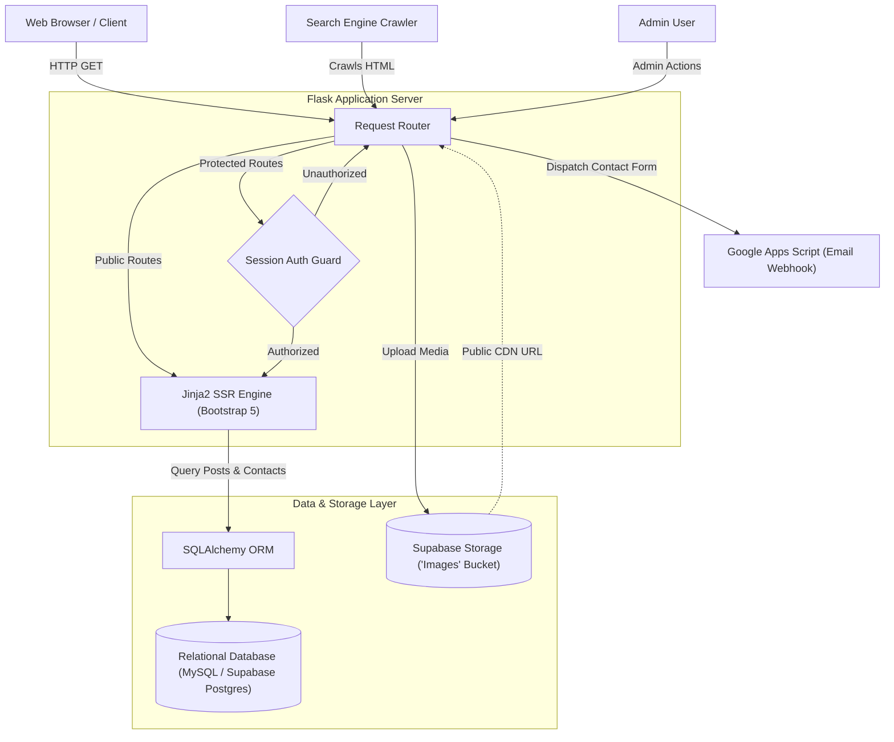
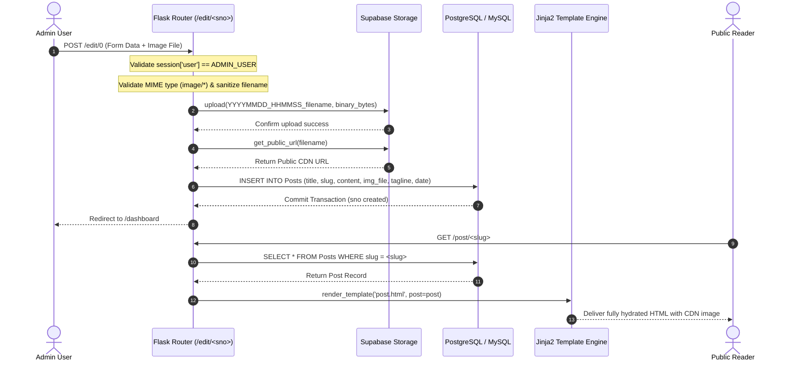
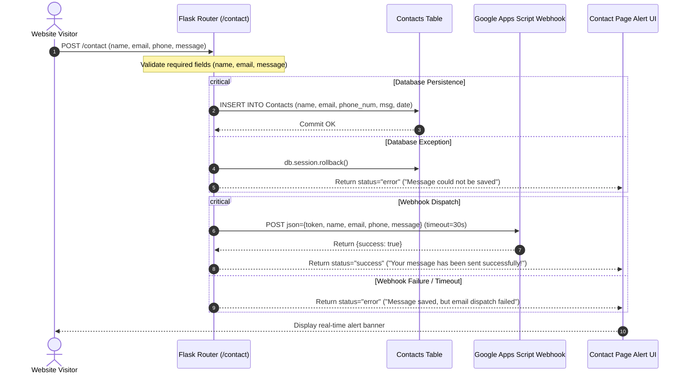

# ⚡ Coding Thunder

> **High-Performance Server-Side Rendered (SSR) Publishing Engine & Content Management System** — An end-to-end dynamic blogging platform engineered with Python, Flask, SQLAlchemy, and Supabase Cloud Storage.

[](https://webproject-jtcc.onrender.com)

[](https://www.python.org/)
[](https://flask.palletsprojects.com/)
[](https://www.sqlalchemy.org/)
[](https://supabase.com/)
[](https://www.mysql.com/)
[](https://supabase.com/docs/guides/storage)
[-FF6F00?logo=fastapi&logoColor=white)](https://flask.palletsprojects.com/)
[](https://gunicorn.org/)
[](https://opensource.org/licenses/MIT)

---

## 📑 Table of Contents

1. [🌟 Overview & Value Proposition](#overview)
2. [⚡ Architecture Comparison: SSR vs. Single Page Apps (SPA)](#comparison)
3. [✨ Key Features](#key-features)
4. [🏛️ System Architecture](#system-architecture)
5. [🔄 Core Execution Workflows](#workflows)
   - [Post Publishing & Media Ingestion Pipeline](#post-publishing-workflow)
   - [Contact Submission & Webhook Dispatch Pipeline](#contact-submission-workflow)
6. [📂 Directory Structure](#directory-structure)
7. [🛠️ Technology Stack](#technology-stack)
8. [🚀 Getting Started & Local Setup](#getting-started)
9. [⚙️ Environment Configuration](#configuration)
10. [🔌 Routes & Interface Reference](#routes-reference)
11. [💡 Usage Guide & Typical Workflows](#usage-guide)
12. [📸 Visual UI & Styling Architecture](#assets-ui)
13. [🧪 Testing & Verification](#testing)
14. [🚢 Deployment Guide](#deployment)
15. [🛡️ Security & Operational Considerations](#security-limitations)
16. [💼 Engineering Highlights & Design Decisions](#engineering-highlights)
17. [🤝 Contributing](#contributing)
18. [👤 Author & License](#author-and-license)

---

<a id="overview"></a>
## 🌟 Overview & Value Proposition

In the modern web landscape, many content platforms rely on bloated Single Page Application (SPA) architectures that require downloading megabytes of client-side JavaScript before rendering a single word. This leads to sluggish First Contentful Paint (FCP), brittle search engine indexing, and fragile dependency chains.

**Coding Thunder** solves this problem by combining the speed, resilience, and crawlability of **pure Server-Side Rendering (SSR)** with modern cloud primitives:

- **Instantaneous Page Delivery**: HTML is hydrated server-side via Flask and Jinja2 in single-digit milliseconds, delivering semantic, pre-rendered markup ready for instant viewing on desktop and mobile browsers.
- **Cloud-Native Media Ingestion**: Direct integration with **Supabase Storage** isolates media assets from local container filesystems, preventing disk bloat and ensuring high-availability asset streaming via global CDN URLs.
- **Decoupled Asynchronous Lead Pipeline**: Visitor contact submissions are persisted locally to transactional database storage and dispatched via HTTP webhooks to an external **Google Apps Script** automation service, avoiding SMTP port blocks and rate limits.
- **Dual-Database Flexibility**: Seamlessly run with local MySQL during development and switch to cloud-hosted PostgreSQL (Supabase) in production through unified SQLAlchemy ORM models.

---

<a id="comparison"></a>
## ⚡ Architecture Comparison: SSR vs. Single Page Apps (SPA)

| Dimension | ⚡ Coding Thunder (Flask SSR) | 🐢 Client-Side Rendering (CSR / SPA) | 🐘 Heavy Monolithic CMS (e.g. WordPress) |
|---|---|---|---|
| **First Contentful Paint (FCP)** | **< 150ms** — Direct server-rendered HTML | 1.5s – 4.5s — Blocked waiting for JS bundles | Variable (300ms – 2.0s) depending on plugin bloat |
| **SEO & Crawler Indexing** | **100% Native** — Zero headless rendering needed | Requires dynamic rendering or complex SSR workarounds | Native, but prone to bloated DOM hierarchies |
| **Client Memory Footprint** | **Zero JS execution overhead** (~1.2 KB custom JS) | High RAM & CPU consumption on low-end devices | Moderate to high due to tracking scripts and plugins |
| **Media Persistence** | **Cloud Object Storage (Supabase CDN)** | Often requires separate S3 microservices | Local disk storage prone to container wipedowns |
| **Operational Complexity** | **Single WSGI process**, minimal dependencies | Multi-repo builds, hydration mismatches, API versioning | PHP runtime, Apache/Nginx, caching plugins, heavy DB |

---

<a id="key-features"></a>
## ✨ Key Features

### 📰 1. Dynamic Server-Side Content Publishing
- **Semantic Article Hydration**: Renders comprehensive blog posts with custom titles, subheadings, and authored timestamps directly from the relational database.
- **Deterministic Pagination Engine**: Configurable post density per page (`no_of_posts`) with mathematical boundary calculations and bidirectional navigation links (`/?page=N`).
- **Dynamic Mastheads & Branding**: Header imagery and global styling adapt dynamically to environment configuration with automatic fallback to local assets.

### 🔐 2. Protected Administrative Portal & CRUD Lifecycle
- **Session-Guarded Access**: Secure admin authentication via `/dashboard` verifying credentials against environment-isolated variables (`admin_user`, `admin_password`).
- **Unified Post Editor**: Single dual-mode route (`/edit/<sno>`) capable of creating new entries (`sno=0`) and modifying existing records (`sno>0`).
- **Cascade Deletion**: Immediate removal of obsolete articles with session authorization verification (`/delete/<sno>`).

### ☁️ 3. Cloud Object Storage Ingestion (Supabase)
- **Inline Image Processing**: Direct multipart file upload via the post editor (`/edit/<sno>`) with MIME-type validation (`image/*`).
- **Collision-Resistant Naming**: Generates timestamped safe filenames (`YYYYMMDD_HHMMSS_ffffff_filename.ext`) using Werkzeug's `secure_filename`.
- **Dedicated Asset Uploader**: Standalone `/uploader` endpoint that queries bucket contents via `supabase.storage.from_("Images").list()`, uploads binaries, and pre-populates the new post workflow via session tracking (`session['uploaded_image_url']`).

### 📬 4. Transactional Lead Capture & Webhook Dispatch
- **Dual-Layer Ingestion**: Form submissions are immediately committed to the `Contacts` relational table with atomic transaction rollback on failure.
- **Serverless Webhook Forwarding**: Dispatches structured payload (`name`, `email`, `phone`, `message`, `token`) to a Google Apps Script web endpoint via `requests.post` with a 30-second timeout.
- **Reactive UI Feedback**: Asynchronous client-side alert indicators that render success or failure notices based on template response context.

---

<a id="system-architecture"></a>
## 🏛️ System Architecture

The architecture of Coding Thunder cleanly separates the client layer, server-side controller layer, and cloud persistence services:



### Component Responsibilities
1. **Client Layer**: Standard browsers, authenticated admins, and web crawlers consume fully hydrated semantic HTML documents. No client-side compilation or heavy runtime is required.
2. **Flask Application Engine**: Powered by Flask 3.x and WSGI (Gunicorn in production), managing URL routing, request parsing, session storage, and Jinja2 template rendering.
3. **Session Auth Guard**: Intercepts mutations on `/edit`, `/uploader`, and `/delete` routes to enforce strict credential-backed session authorization.
4. **Data Persistence (SQLAlchemy)**: Provides vendor-agnostic object-relational mapping. Connects dynamically to MySQL for local development or PostgreSQL on Supabase in production.
5. **Supabase Cloud Storage**: Stores image assets in an external cloud bucket, generating permanent, secure CDN URLs referenced by the `Posts` database model.
6. **External Email Webhook**: Handles lead notifications via Google Apps Script without coupling the web server to SMTP daemons.

---

<a id="workflows"></a>
## 🔄 Core Execution Workflows

<a id="post-publishing-workflow"></a>
### Post Publishing & Media Ingestion Pipeline
This workflow illustrates how an administrator writes a blog post, uploads a header image to Supabase, and publishes it to the database:



---

<a id="contact-submission-workflow"></a>
### Contact Submission & Webhook Dispatch Pipeline
This sequence shows the resilient dual-stage persistence and notification mechanism for visitor inquiries:



---

<a id="directory-structure"></a>
## 📂 Directory Structure

```
webproject/
├── .env.example              # Environment configuration template
├── .gitignore                # Version control ignore definitions (venv, cache, local tests)
├── main.py                   # Central application entry point: routes, models, storage
├── requirements.txt          # Python dependency specifications
├── static/                   # Static assets delivered directly to clients
│   ├── assets/
│   │   ├── favicon.ico       # Website browser icon
│   │   └── img/
│   │       └── post_back.jpg # Fallback masthead background image
│   ├── css/
│   │   ├── signin.css        # Layout styling for the admin sign-in portal
│   │   └── styles.css        # Clean Blog theme stylesheet (Bootstrap 5)
│   └── js/
│       └── scripts.js        # Responsive mobile navigation & scroll-reactive header logic
└── templates/                # Jinja2 server-side rendering HTML templates
    ├── about.html            # Static biography and project information page
    ├── contact.html          # Contact form with validation and dynamic status alerts
    ├── dashboard.html        # Protected administrative control panel (post table & uploader)
    ├── edit.html             # Blog post authoring form (Create/Update with file attachment)
    ├── index.html            # Public homepage listing blog posts with dynamic pagination
    ├── layout.html           # Master boilerplate template (navigation, footer, font imports)
    ├── login.html            # Administrator authentication form
    └── post.html             # Full article reading interface with masthead hero
```

---

<a id="technology-stack"></a>
## 🛠️ Technology Stack

### Backend & Core Framework
- **[Python 3.10+](https://www.python.org/)**: Primary application runtime.
- **[Flask 3.x](https://flask.palletsprojects.com/)**: WSGI microframework for routing and SSR rendering.
- **[Werkzeug](https://werkzeug.palletsprojects.com/)**: Filename sanitization (`secure_filename`).
- **[python-dotenv](https://github.com/theskumar/python-dotenv)**: 12-Factor environment variable management.

### Persistence, ORM & Cloud Storage
- **[Flask-SQLAlchemy](https://flask-sqlalchemy.palletsprojects.com/)**: Object-relational mapping and connection management.
- **[PostgreSQL (Supabase)](https://supabase.com/)**: Production relational database.
- **[MySQL (mysqlclient)](https://www.mysql.com/)**: Local development database.
- **[psycopg2-binary & psycopg](https://www.psycopg.org/)**: PostgreSQL drivers for Python.
- **[Supabase Python SDK (`supabase`)](https://github.com/supabase/supabase-py)**: Cloud Object Storage integration for media assets.

### Frontend & Communications
- **[Jinja2](https://jinja.palletsprojects.com/)**: Server-side template hydration.
- **[Bootstrap 5.2.3](https://getbootstrap.com/)**: Responsive CSS components.
- **[Font Awesome 6.3.0](https://fontawesome.com/)**: Vector icons.
- **[Requests](https://requests.readthedocs.io/)**: Asynchronous webhook dispatch for contact inquiries.

### Production WSGI
- **[Gunicorn](https://gunicorn.org/)**: Multi-worker UNIX WSGI HTTP server.

---

<a id="getting-started"></a>
## 🚀 Getting Started & Local Setup

### Prerequisites
- **Python 3.10+** installed
- **Git** installed
- A running relational database (local **MySQL** or a **Supabase PostgreSQL** instance)
- A **Supabase project** with a public storage bucket named **`Images`**

### Setup Commands (Windows / Linux / macOS)

Follow the unified terminal steps below. Note the commented alternative for your specific operating system:

```bash
# 1. Clone the repository
git clone https://github.com/varkush123/webproject.git
cd webproject

# 2. Create a virtual environment
python -m venv venv

# 3. Activate the virtual environment
# --- On Windows (PowerShell) ---
.\venv\Scripts\Activate.ps1
# --- On Linux / macOS ---
source venv/bin/activate

# 4. Install dependencies
python -m pip install --upgrade pip
pip install -r requirements.txt

# 5. Copy environment template
# --- On Windows (PowerShell) ---
Copy-Item .env.example .env
# --- On Linux / macOS ---
cp .env.example .env

# 6. Configure your variables in .env (see section below)
# Open .env with your editor of choice (e.g. notepad, code, nano, or vim)

# 7. Start the development server
python main.py
```

The application will be accessible at:
```
http://127.0.0.1:5000/
```

---

<a id="configuration"></a>
## ⚙️ Environment Configuration

All environment variables, requirement statuses, and default fallback values are documented directly inside [`.env.example`](.env.example).

To configure your environment:
1. Copy [`.env.example`](.env.example) to `.env`.
2. Review the inline explanations inside `.env` to configure your database connection, admin credentials, and Supabase storage keys.

> [!IMPORTANT]
> **Database Mode (`local_server`)**: Set `local_server=True` for local development against MySQL (uses `local_uri` and maps post image column to `"img_file"`). Set `local_server=False` in production when connecting to Supabase PostgreSQL (uses `prod_uri` and maps post image column to `"image_url"`).

---

<a id="routes-reference"></a>
## 🔌 Routes & Interface Reference

### Public Routes
- **`GET /`**: Homepage with paginated blog post cards (`?page=N`).
- **`GET /post/<post_slug>`**: Full article reading view querying by URL slug.
- **`GET /about`**: Biographical page rendering `about_text`.
- **`GET, POST /contact`**: Contact form rendering (GET) and lead submission with webhook dispatch (POST).
- **`GET /hello`**: Lightweight health check endpoint (`200 OK`).

### Protected Administrative Routes
- **`GET, POST /dashboard`**: Admin authentication form (POST) and post management table (GET, session-guarded).
- **`GET, POST /edit/<sno>`**: Create a new post (`sno=0`) or edit existing article (`sno>0`) with file upload to Supabase.
- **`POST /uploader`**: Quick file upload to Supabase `"Images"` bucket with redirect to `/edit/0`.
- **`GET, POST /delete/<sno>`**: Removes post by ID with admin session verification.
- **`GET /logout`**: Clears admin session and redirects to `/dashboard`.

---

<a id="usage-guide"></a>
## 💡 Usage Guide & Typical Workflows

### 1. Authenticating as Administrator
1. Navigate to `/dashboard`.
2. Enter the credentials configured in `admin_user` and `admin_password`.
3. View the management catalog with Edit/Delete controls and upload tools.

### 2. Creating a Post with Cloud-Hosted Media
1. Click **Add a new post** (`/edit/0`).
2. Fill in the **Title**, **Tagline**, **Slug** (e.g., `getting-started-with-flask`), and **Content**.
3. Select an image file under **Upload new image**.
4. Click **Submit** — the binary is uploaded to Supabase Storage, the CDN URL is attached, and the record is stored in the database.

---

<a id="assets-ui"></a>
## 📸 Visual UI & Styling Architecture

- **Clean Blog Design System**: Built on Bootstrap 5 (`static/css/styles.css`) with Google Fonts (*Lora* and *Open Sans*).
- **Adaptive Sticky Navigation**: `static/js/scripts.js` calculates scroll position: scrolling down hides the bar; scrolling up reveals a fixed navigation bar with background blur.
- **Fallback Imagery**: Defaults to local asset `static/assets/img/post_back.jpg` whenever cloud hero images are omitted.

---

<a id="testing"></a>
## 🧪 Testing & Verification

1. **Endpoint Health Check**:
   ```bash
   curl -I http://127.0.0.1:5000/hello
   # Expected: HTTP/1.1 200 OK
   ```

2. **Database & Storage Connectivity**:
   On application startup (`python main.py`), `ping_supabase()` executes in the entry point hook to confirm database and storage bucket accessibility.

---

<a id="deployment"></a>
## 🚢 Deployment Guide

### Running with Gunicorn (Production WSGI)
```bash
gunicorn -w 4 -b 0.0.0.0:5000 main:app
```

### Deploying to Cloud PaaS (Render, Railway, Fly.io)
1. Link your GitHub repository.
2. Build command: `pip install -r requirements.txt`.
3. Start command: `gunicorn main:app`.
4. Add environment variables from `.env.example`, setting `local_server=False` to connect to production PostgreSQL.

---

<a id="security-limitations"></a>
## 🛡️ Security & Operational Considerations

- **Secret Decoupling**: Credentials and database URIs remain in `.env` and are never committed to version control.
- **File Sanitization**: Uploaded filenames are sanitized through Werkzeug's `secure_filename`.
- **Session Protection**: Flask cookies are signed using `FLASK_SECRET_KEY`.
- **Storage Cleanup**: Deleting a post removes the database record; deleting remote assets directly from the Supabase bucket can be performed via the Supabase dashboard.

---

<a id="engineering-highlights"></a>
## 💼 Engineering Highlights & Design Decisions

1. **SSR Performance**: Server-side hydration renders pages with zero client-side JavaScript bundle download delays, achieving fast initial load times and seamless crawler indexing.
2. **Cloud Storage Offloading**: Storing uploaded images in Supabase Storage instead of local container filesystems ensures zero disk bloat and persistent assets across container redeploys.
3. **Decoupled Webhook Dispatch**: Delegating contact emails to a Google Apps Script webhook eliminates SMTP port restrictions common to cloud hosting providers.

---

<a id="contributing"></a>
## 🤝 Contributing

1. Fork the repository (`https://github.com/varkush123/webproject`).
2. Create your feature branch (`git checkout -b feature/AmazingFeature`).
3. Commit your changes (`git commit -m 'Add some AmazingFeature'`).
4. Push to the branch (`git push origin feature/AmazingFeature`).
5. Open a Pull Request.

---

<a id="author-and-license"></a>
## 👤 Author & License

### Author
- **Varsha Kushwaha** ([@varkush123](https://github.com/varkush123)) — *Primary Maintainer & Developer*
- Email: [kushwahavarsha270@gmail.com](mailto:kushwahavarsha270@gmail.com)
- Repository: [varkush123/webproject](https://github.com/varkush123/webproject)

### License
This project is open-source software published under the **[MIT License](https://opensource.org/licenses/MIT)**.
